# ELK
# Kibana
## Discovery
your exploration of the dataset.  From which fields are
coming in to how your data is structured with respect to the datatypes of the fields, everything can be
visible in Discover.  It also has an amazing query feature, which serves as your own custom search
functionality placed over whatever dataset you have in the Elasticsearch cluster.
- Exploring your data
- Working with queries
- Creating a saved search

### Exploring your data
Anything that we ingest in the cluster gets stored in the cluster as a
document. Elasticsearch – a document store Before starting to understand how exploration of data can be done, Elasticsearch is called a
distributed document store as it stores the data in the form of serialized JSON documents.
<p align="center">
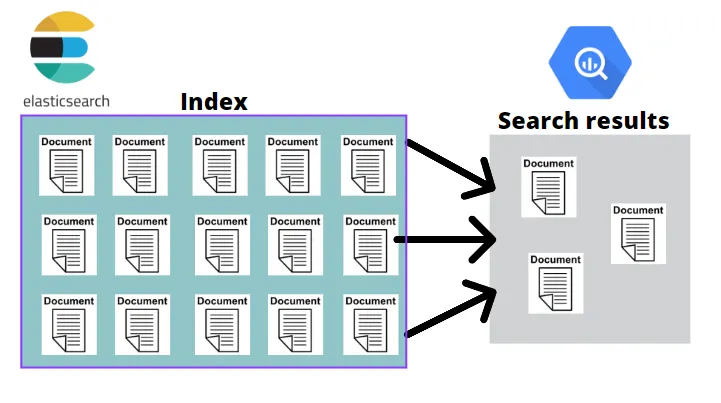
</p>

The preceding tabular structure of one record, if ingested into the Elasticsearch cluster, will be converted to a flat JSON document as follows:
```json
{
    "SrNo":1,
    "name":"John",
    "Address":"UnitedStates",
    "VisaStatus":"Approved"
}

```
One field can be indexed in multiple ways for it to be searched for specific purposes. For example, a
string field can be indexed as a text to use it for full-text search, and it can also be indexed as a
keyword field to facilitate case-sensitive searching or sorting functionality, or to perform various
aggregations on the data.
Let’s talk more about the datatypes now
## DataTypes in ElasticSearch
Datatypes in Elasticsearch
It is very important to understand how your data is being modeled from the backend to use these
datatypes, as it impacts the way the field is going to be searched.
The datatypes, typically called field mappings in Elasticsearch, will be dynamically assigned by
default. Date, IP, Text, Numeric, Boolean, and Geo points are the key datatypes. Elasticsearch
detects the datatypes and maps them to the respective field mapping. Hence, we can also call
Elasticsearch schemaless, because we need not define the datatypes before the data gets ingested into
the cluster.
In the Discover interface, in the left-most section, we can locate the available list of fields in the
selected data view. The tiny icon beside each field denotes the type of field mapping each field is
mapped to. This is shown in the following screenshot:
<p align="center">
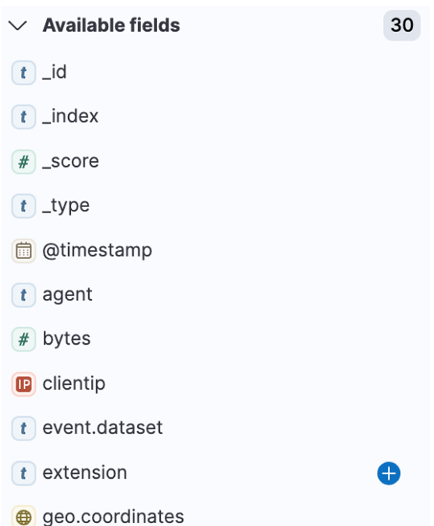
</p>

The abbreviated icons can be understood as follows:
- t: String datatype
- #: Numeric datatype
- Globe: Geo point datatype
- IP: IP datatype
- Calendar: Date/timestamp datatype
As much as dynamic mappings work well for most cases, it is also a best practice to create your own
mappings by creating an index first before ingesting the data so that you can model the fields as per
the use case’s search and write requirements.
## The Discover Page
As we begin elaborating on the features of the Discover page, the two most important features to set
the context of the search are described as follows:
- <b>Setting up a time filter</b>: This is one of the first steps we do when we visit the page for the first time. It is an essential step to
perform that will show us the data in the range we set the time filter in. For example, by default, the time filter is set to previous
15 minutes, which means that Discover would be showing us the data that has come into the cluster in the previous 15 minutes.
We can increase the time range or set up any particular date range in which we are looking to explore the data
<p align="center">
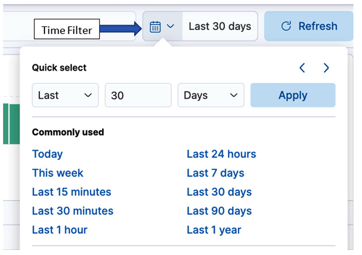
</p>

- <b>Selecting the data view</b>: Selecting which data view you wish to explore is a key step because that will determine which dataset
you can now start exploring. You can select/switch between different data views through this drop-down feature. The following
available list section will be updated dynamically as we select the type of data view:
<p align="center">
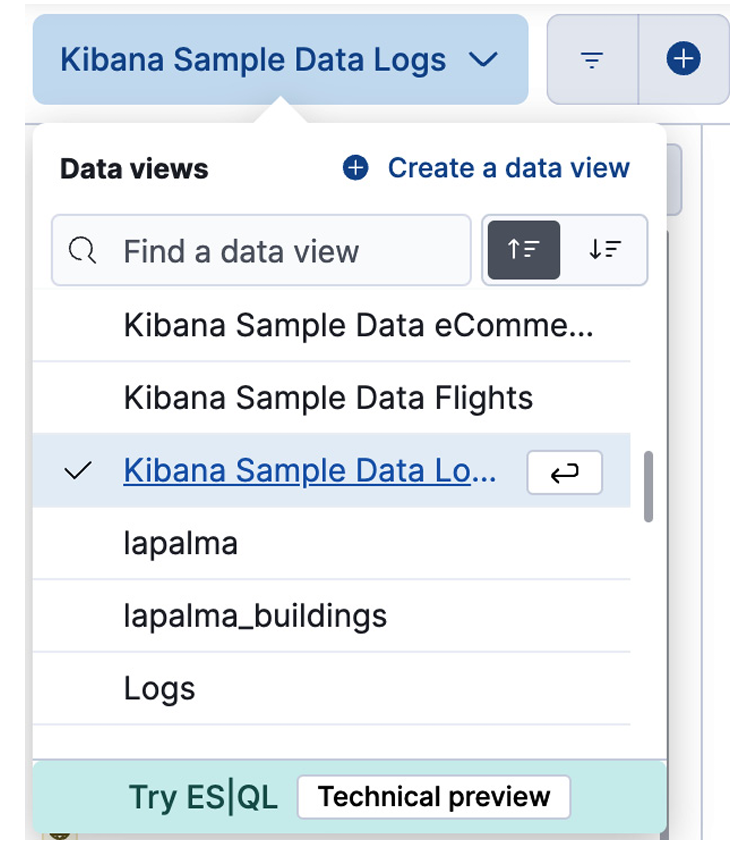
</p>

So far, we have learned about a few initial features of the page, and now we’ll move on to exploring
the search part of the interface, which will enable us to perform certain search queries on our data in
the cluster.

## Working with Queries
### Structuring KQL query (example)
Kibana Query Language, abbreviated as KQL, is a text-based query language that is used to filter
data in Kibana. It works on a simple syntax of just searching for the terms we’re looking for in the
search bar, or being more specific on what we’re searching for by providing a field against the word,
shown as follows
```
"field": "value"
```
For example, if I have a field called OS and I am searching for the term Linux in that
field, then I can frame my search as follows:
```
"OS": "linux"
```
This will be a case-insensitive search as by default, it will access the text type of field mapping. It is
important to note that, as we previously learned, our string fields are mapped twice – once as text
field mapping and again as keyword field mapping. Hence, we can be specific here as to which field
mapping we refer to for the search; for example, if we wish to do a case-sensitive search, we can do
the following
```
"OS.keyword": "Linux"
```
The field parameter is optional, hence we can also perform the same search using just the term itself,
which is as follows:

Linux or linux

The preceding search will search for the term across all the fields in the data view.

## Pairing the queries with Boolean operators

We can combine different query criteria to search with the help of Boolean operators – and/or (case
insensitive). For example, if we have two fields to search on, category and error_code, then the
search can be framed as follows:
```
"Category": "Engineering" AND "error_code": 404
```
Searching numeric fields
If we have numbers to work with, we could use operators such as >, <, >=, and <= and use them in
different combinations of the Boolean operators, as stated in the preceding section. For example, if
we want to have both types of operators implemented on two fields, category and bytes, then it can
be done as follows
```
"category": "engineering" OR "bytes" > 500

```
## How to search when you don’t know how to spell what you wish to search for
How many times have you googled an incorrect spelling of a word? There are numerous times when
a user cannot spell the words correctly when searching. That is where the flexibility of having a typo
comes into play, and we have the wildcard syntax to the rescue for the moment. For example, to find
documents where customer_firstname starts with s, we can implement a KQL query as follows:
```
"customer_firstname": "s*"
```

Here, * matches to zero or more characters. If you want to only match one character, you can use the
? character.
In this section, we deep-dived into different ways to search your data across your cluster with the
help of KQL. We also learned about distinct features to add flexibility to search the data in case users
are unaware of the exact terms they are searching for. If we wish to leverage the Lucene query
language in place of a filter, we can switch to Lucene from KQL by clicking the Query menu icon,
as shown in the following screenshot
<p align="center">
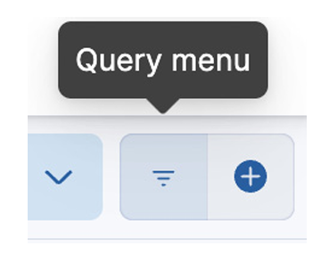
</p>

Let’s level this up by understanding the concept of filters in Discover, which do the same job but with
better ease of access and use.
Understanding filters
Queries such as KQL help us to create search statements based on specific criteria, but we can also
use filters as sticky queries that help us to create pretty much the exact same results as queries,
buwith more flexibility to perform various actions such as negate, pin, disable, and delete. Refer to the
following screenshot 

<p align="center">
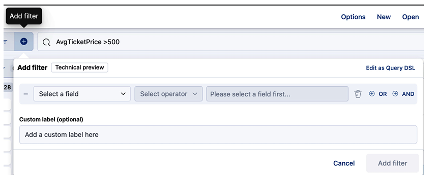
</p>

The process of creating a filter is straightforward, where you select a field from the drop-down menu
and enter the values it needs to match to form a search:

The moment we create a filter or a KQL query, it is going to convert to a <b>domain-specific language</b>
query in the backend, which is going to interact with Elasticsearch and get the response back to us in
the space called <b>document table</b>. There will be a list of documents, which, if expanded (by clicking
the <b>Expand</b> button), will show us the data in tabular format as well as the
JSON format:
<p align="center">
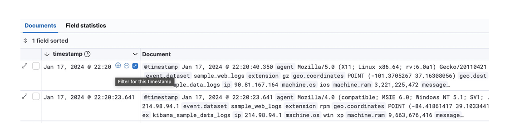
</p>


<b> *** Expanded Document ***</b>

<p align="center">
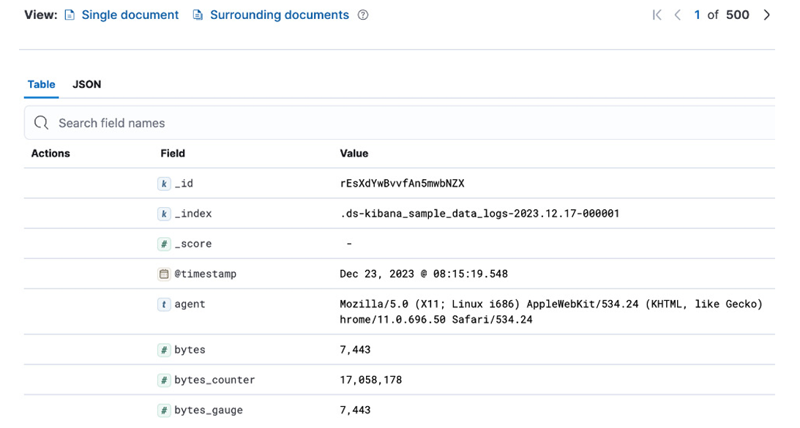
</p>

Furthermore, to give you some more insight into the trend/flow of the data in the cluster, Discover
has a very interesting graph on the top, which is called a data histogram:

<p align="center">
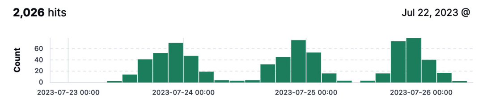
</p>

## Creating a saved search
A saved search is a search created by saving the search results of the query done by KQL or a filter
on Discover. It can be further used to add in as a saved search on a dashboard to display a specific set
of documents representing a specific use case/query.
A saved search can also be a great way to reuse the search made on Discover. Furthermore, the
results in the form of documents can be added to the dashboard along with the other visualizations.
Let us see how we can create a saved search, step by step


Steps to create a saved search
Creating a saved search is a fairly simple process where you have a specific use case in mind and
need to host your search in that exact direction. Let’s see how to begin with creating a saved search:
1. Go to the main menu of Kibana and open Discover:
2. Select the data view according to the dataset you wish to work on
3. Select the use-case-appropriate date range in the time filter:
4. Implement a search in the form of KQL, a filter, or both:
5. Go to the Save option in the top-right corner and save it with a relevant name:
Once we create the search and receive the results in the documents table, we can then navigate to
saving it by clicking the Save button at the top of the page:

<p align="center">
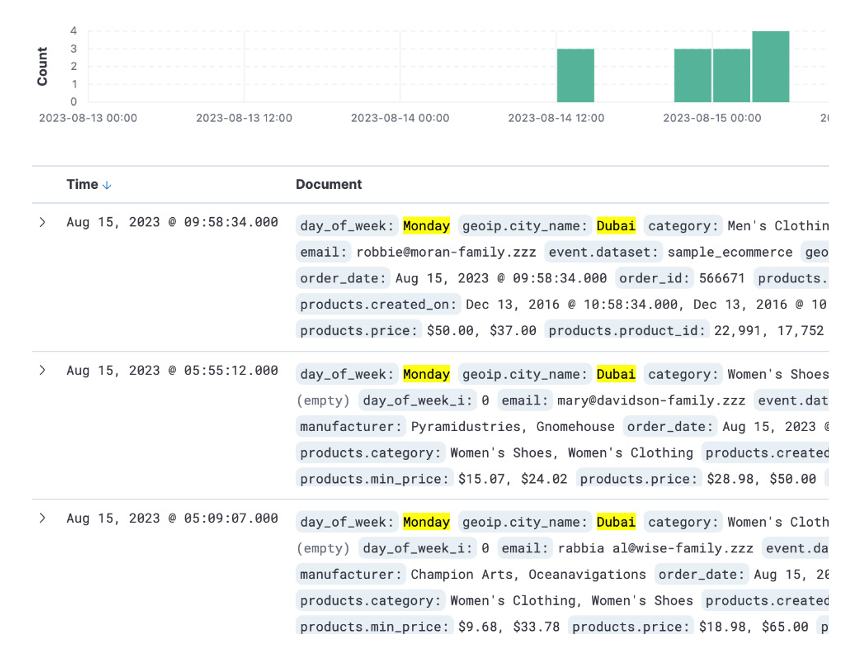
</p>

## Data Analysis with Machine Learning
Machine learning has revolutionized the way we analyze and interpret data. With its advanced algorithms, it has become easier to uncover patterns and trends that were once hidden. One such tool
that harnesses the power of machine learning is Kibana. Kibana provides a free Data Visualizer feature, enabling users to gain deeper insights into their data. If your data is stored in Elasticsearch
and includes a time field, Data Visualizer can help you identify potential fields for anomaly detection. Anomaly detection is crucial in today’s rapidly evolving landscape as it allows us to detect unusual or
suspicious activities that may indicate cyberattacks, infrastructure problems, or business issues.
By leveraging machine learning algorithms, Kibana’s anomaly detection feature can automatically spot anomalies in your data without the need for extensive human effort. This saves valuable time
and resources while ensuring that critical events are promptly identified and addressed. With Kibana’s Data Visualizer and machine learning capabilities, businesses can gain a comprehensive
understanding of their data, even in large and complex datasets. By detecting anomalies, organizations can proactively respond to potential threats or problems before they escalate. By
reducing the burden of manual inspection and rule maintenance, organizations can focus on strategic decision-making and problem-solving.
In this chapter, we shall study three very important aspects of machine learning that are available in the machine learning interface of Kibana:
Understanding anomaly detection in time series data
Analyzing data with entity-centric analysis Setting up alerts
<b> Technical requirements</b>

As per the basic requirements, we assume that you have data ingested in the cluster and that Elasticsearch and Kibana are set up on the nodes of (any) environment (cloud or local).

<b> Understanding anomaly detection in time series data </b>

Anomaly detection is the process of identifying the points in data that don’t fit the normal data
behavioral patterns. To make this effective, we can automate the whole process. The important point
to note here is that this process will be more efficient when the size of the data has increased. The
Elastic Stack supports several data analysis use cases that use supervised and unsupervised machine
learning, as follows:
- Anomaly detection
- Outlier detection
- Fraud detection
- Forecasting
- Language detection

Our main intention behind putting various techniques to use is to bring out the insights from the most
normal-looking data. When we look into anomaly detection, we identify patterns and unusual
behavior in the near real-time current and historical data. An unusual data point can be seen in the
form of a high spike or very low data behavior, as shown here:

<p align="center">
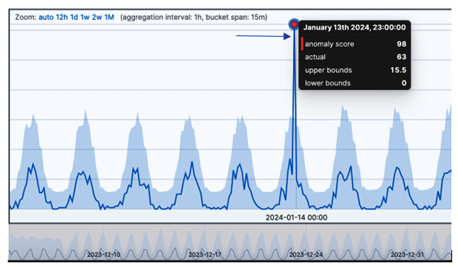
</p>

<b> The key terminological terms to keep in mind are as follows:</b>

Detector: This is the combination of an analytical function and the field we are targeting to create a machine learning job
Model: The graph created by an anomaly detection job to depict the usual behavior of the data
Influencer field: The field that we wish to use and that influences (contributes to) the creation of anomalies
Next, we will understand the step-by-step workflow for performing the detection job:
1. The first step is to plan what the workflow of the analysis is going to look like. As per the proprietary machine learning algorithm,
the anomalies can be related to time-related deviations in counts and frequencies, statistical rarity, or unusual behavior in
geographic data or from a member of a population in the analysis job. According to the dataset that you have, and the type of
behavior you wish to detect, you can determine the type of anomaly detection job and begin analysis.
2. The second step is to run the detection job in the machine learning app by selecting the appropriate type of wizard. The following
screenshot shows the screen where you can select this

<p align="center">
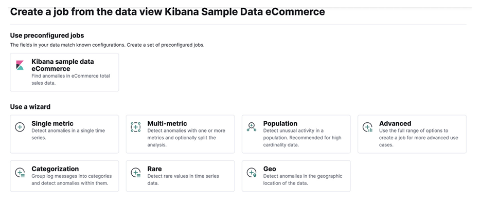
</p>

Single metric jobs will use a single detector to create a detection job on the dataset we select,
whereas Multi-metric jobs will have multiple detectors to complete the same process, except the
latter is much more efficient in running multiple analyses at the same time.
Population, as we understood earlier, helps you create a job that detects anomalies that are unusual
compared to the behavior of the rest of the population. The other wizards can be used to create jobs
that log events into categories and use count or rate analytical functions to find anomalies.
When we click on one of the wizards (for example, Single metric) and go to the last page to Create
Job, there are two main result views that you should consider looking into:
- Single Metric Viewer: The view of the created anomaly detection job will look something similar to the following:

<p align="center">
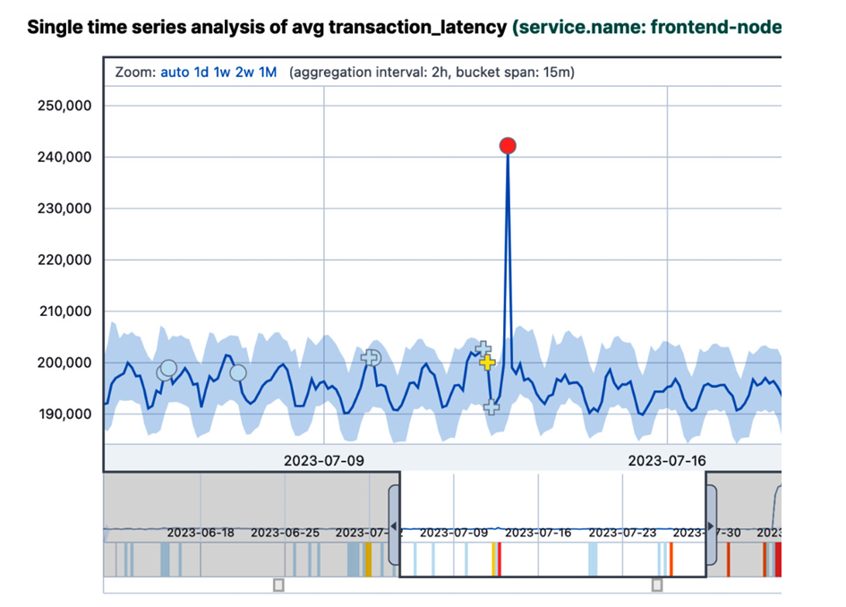
</p>

The slider at the bottom of the figure serves as a magnifying glass that will highlight the part of the
graph that’s been selected by the slider. The red dot on the graph indicates an anomaly; its severity is
based on the anomaly score, which is calculated from 0 to 100. If we click on the red dot, it will
provide details about the score, as shown in the following screenshot:

<p align="center">
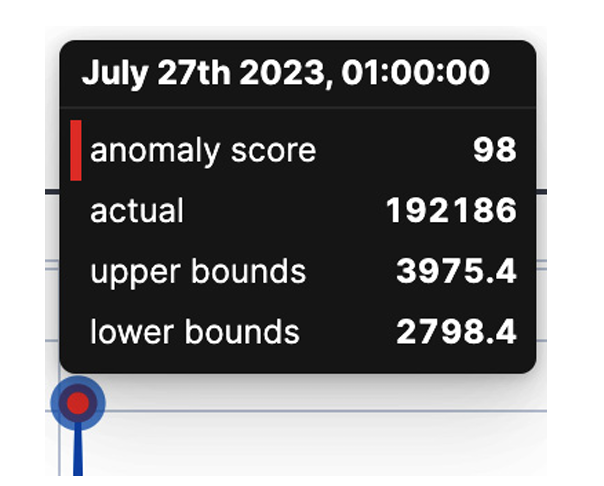
</p>

As we can see, the score is 98, which is considered a pretty high score. The higher the value, the
more severe the anomaly is. If we scroll down on the viewer, we’ll see details about the exact events
due to which these anomalies are happening in the data. This is great to have when you plan to do a
deep root analysis on the data events causing the concerning spikes or lows.

- Anomaly Explorer: This view will consolidate all the anomalies that have been found in the whole job and summarize them in
this window. On the left-hand side of the view is a list of all the top influencer field values regarding the detected anomalies. This
contains the anomalies with maximum scores, where the swim lanes depict the respective values of the influencer field. To see
this in action, check out the view of Anomaly Explorer shown in the following screenshot:

<p align="center">
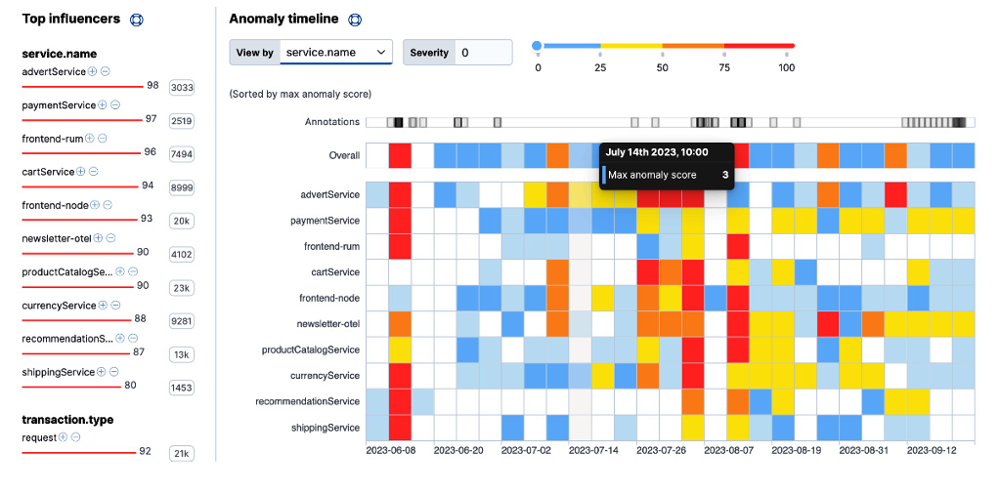
</p>

